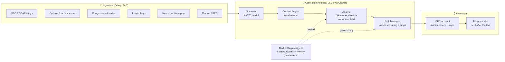

# ☀️ Helios Hedgefund

An autonomous **trading research system** that watches markets around the clock, generates AI-scored investment theses, sizes positions under a rule-based risk framework, and executes without a human approval gate.

This is a personal research project studying whether an LLM-driven agent pipeline can make consistently good trading decisions. Every decision, conviction score, and outcome is logged to build a long-term dataset for analysis.

**Live since August 2026, at deliberately small size.** The system ran paper-only from June to August 2026; a `TRADING_ENV` switch now selects paper or live, and every stateful table is scoped by environment so the two track records never mix. Position sizing rescales with account size, so the percentage caps quoted below are the large-account values — small balances get different (looser, because of whole-share granularity) limits. See `config.py`.

> ⚠️ **Not financial advice. Not a product.** Nothing here is a recommendation to buy or sell anything. This trades real money at small size and can lose it. Run at your own risk.

---

## How it works

Market events flow through a pipeline of specialized agents. Each stage can kill a candidate; only trades that survive every gate reach the broker. There is no human approval step — a Telegram alert is sent after the fact.



### The pipeline in one trade

1. **An event fires** — say, an 8-K filing or an unusual options sweep on a watchlist ticker.
2. **Screener** (fast local LLM) decides in seconds whether it's relevant and urgent.
3. **Context Engine** assembles a situation brief: price action, fundamentals, catalyst calendar, prior theses from the vector store.
4. **Analyst** (large local LLM) writes an investment thesis with a 1–10 conviction score, an upside/downside estimate, and a bucket classification (Compounder / Accelerator / Moonshot). Below conviction 5 or 2:1 upside/downside, it dies here.
5. **Risk Manager** sizes the position from a bucket × conviction table, scaled by the current market regime multiplier, and computes an ATR-based stop. Concentration caps (per-position, per-theme, total moonshot exposure) are enforced here.
6. **Execution is automatic.** Trades that clear the Analyst and Risk Manager gates execute immediately against **Interactive Brokers** — a stop is placed, the trailing-stop monitor takes over, and a Telegram alert is sent after the fact rather than an approval request beforehand. (Earlier versions gated every trade on a Telegram Approve/Reject tap; that gate was removed on 2026-07-14 while the system was paper-only. Unattended live execution requires two separate opt-ins — `TRADING_ENV=live` *and* `LIVE_TRADING_ENABLED` — so flipping one value cannot by itself start trading real money. Drawdown halt, concentration caps, and price-drift-abort checks are unchanged in both environments.)
7. At 30/60/90 days, outcomes are recorded against the original thesis — the dataset that makes this research rather than gambling.

---

## The interesting parts

**🎛️ Market regime engine** — Seven weighted signals (trend, VIX with a contrarian guard, liquidity, credit spreads, breadth, volume, and an empirical **Markov persistence signal**) produce a 0–100 score mapped to five regimes, from Strong Risk-On to Strong Risk-Off. The regime scales every position size — a 9/10-conviction idea in a Risk-Off regime still gets cut in half.

**🔗 Markov persistence signal** — Classifies each day into bull/sideways/bear from 20-day SPY returns and estimates a transition matrix from **non-overlapping windows** (overlapping windows share 19/20 closes and wildly overstate trend stickiness — a subtle bias most retail backtests have). The current state's `P(→bull) − P(→bear)` feeds the regime score.

**🛡️ Risk framework as code** — Drawdown halt at −10% from the high-water mark, per-bucket entry caps (12% / 7% / 2% at standard account size), a 2%-of-equity risk budget per trade under a 7% total portfolio heat cap, theme concentration limits, correlation-based size reduction, ATR stops by bucket, trailing stops that activate after gains, and a startup reconciliation pass that detects positions the broker knows about but the database doesn't — then adopts them with a conservative stop and flags them for human review. Sizing is deterministic and unit-tested; the LLM has no path to change a limit.

**📐 Account-size tiers** — Percentage caps tuned for a large account produce sub-one-share allocations on a small one, which silently drops trades. Caps, minimum conviction, and max concurrent positions therefore rescale across three tiers (Standard / Reduced / Micro), preserving the ratios between buckets rather than just raising the ceiling. A consequence worth stating plainly: at small balances, per-position concentration is *much* higher than the headline 12% / 7% / 2%.

**🧠 Local-first AI** — All LLM inference runs locally on Ollama (Qwen 2.5 at 7B/72B/3B for screening/analysis/chat), on two consumer GPUs; sentence-transformer embeddings for the vector store run locally on CPU. No cloud AI APIs, no API costs, no data leaves the machine, and every agent degrades gracefully to keyword heuristics if the model server is down.

**📚 Knowledge base as strategy** — The watchlist, sector theses, risk rules, and portfolio philosophy live in versioned markdown (`knowledge/`), loaded into agent prompts and a ChromaDB vector store. Changing strategy is a git commit, not a code change.

**🔁 Self-calibration loop** — Closed trades are grouped by the conviction the Analyst *stated at entry*, and the realized win rate and average alpha vs. SPY for each conviction level are fed back into the Analyst's own prompt, which is told to calibrate against that record "not against how confident you feel." The same loop runs per sub-score. If conviction-9 calls historically realized conviction-6 outcomes, the model is shown that before it scores the next one.

**🔧 Fault tolerance** — Position/stop reconciliation every 15 minutes, approval auto-expiry, implausible-price rejection, schema-versioned migrations, and a process manager that supervises every service with logs surfaced in the dashboard.

---

## Evaluation — and why there are no backtests

**This system is evaluated forward only.** There is no backtest harness, and that is a deliberate choice rather than a missing feature.

The Analyst is a general-purpose LLM whose pretraining corpus almost certainly contains the price history, news, and filings for the tickers it reasons about. Backtesting it over any period before its training cutoff cannot distinguish reasoning from recall — the model may simply remember what happened. No amount of careful windowing fixes that, because the contamination is in the weights, not in the data pipeline. So historical "performance" would be unfalsifiable, and the honest move is not to report it.

What *is* trustworthy is the forward record: every decision was made before its outcome existed. That record is built deliberately rather than incidentally:

- Each decision stores the full thesis JSON, the full risk verdict, the stated conviction and sub-scores, the position size, and the stop.
- SPY is stamped at entry, so **alpha vs. SPY** is computed per trade at exit — not just raw return.
- Outcomes are recorded at 30 / 60 / 90 days against the original thesis.
- Realized slippage between the decision price and the fill is recorded per order, cost-signed for both sides.

Known limitations, stated rather than buried: the live sample is small and has limited statistical power; transaction costs beyond measured slippage are not modeled; and the Markov regime model's transition matrix is fit on history and applied to that same history, so it is in-sample. The one methodological care taken there is that its transition matrix is estimated from **non-overlapping** 20-day windows, since overlapping windows share 19 of 20 closes and badly overstate trend persistence.

---

## Stack

| Layer | Tech |
|---|---|
| Agents / LLMs | Ollama (Qwen 2.5 3B/7B/72B), custom pipeline in Python |
| Execution | Interactive Brokers TWS API (`ib_async`), paper + live environments |
| Orchestration | Celery + Redis — ~20 scheduled tasks, from 5-min portfolio snapshots to weekly calendar refreshes |
| Data | Postgres (Supabase), ChromaDB vector store, SQLite catalyst calendar |
| Market data | Polygon, Alpaca data API, yfinance, FRED, SEC EDGAR, Unusual Whales, Quiver |
| UI | Streamlit dashboard (portfolio, regime, signals, logs, manual trade) + Telegram bot |
| Ops | systemd service, single-command launch, ~28k lines of Python, 27 test files (313 tests), CI via GitHub Actions |

---

## Running it

```bash
# Ubuntu prerequisites
sudo apt install -y python3-venv python3-pip build-essential redis-server
curl -fsSL https://ollama.ai/install.sh | sh

# Setup: venv, dependencies, .env template, Ollama models
bash setup.sh

# Fill in .env (Supabase, Telegram, market-data API keys). Set TRADING_ENV=paper
# (the default) to start; it derives the broker port and client ID for you.
# Start IBKR TWS/Gateway with the API enabled, then:
./launch.sh          # dashboard at http://localhost:8501
```

For unattended operation, see [`deploy/systemd/`](deploy/systemd/).

Verification: `python scripts/test_connection.py` (broker), `python scripts/smoke_test.py` (models/data), `python -m pytest tests/` (unit tests).

---

## AI assistance

Parts of this codebase were written with AI coding assistants (Claude Code).
Since October 2026, every AI session on this repository is logged: each
request, the AI-refined version of it, what was changed, and the commit, in
[`research-log/`](research-log/). Entries name the files and functions the AI
generated. The protocol is in [`.claude/CLAUDE.md`](.claude/CLAUDE.md).

---

## Repository layout

| Path | What's there |
|---|---|
| `main.py`, `tasks.py` | Entry point and the Celery task schedule (ingestion, pipeline runs, monitors) |
| `agents/` | Screener, Analyst, market regime and Markov models, candidate scanner, crew orchestration |
| `risk_manager.py`, `execution.py`, `ibkr.py` | Position sizing and stops, order execution, broker client |
| `context_engine.py`, `vector_store.py`, `knowledge_loader.py` | Situation briefs, ChromaDB retrieval, knowledge-base loading |
| `ingestion/` | One module per data source (EDGAR, options flow, insider, congressional, macro, news, ...) |
| `catalyst_service/` | Earnings, sector and macro event calendar (SQLite) |
| `knowledge/` | Watchlist, sector theses and risk rules in markdown, loaded into prompts |
| `db.py`, `config.py` | Postgres schema and migrations; every tunable limit |
| `dashboard.py`, `telegram_bot.py`, `chat_assistant.py`, `standby_bot.py` | Streamlit UI, Telegram alerts and chat |
| `deploy/` | systemd units, watchdog, log rotation for unattended operation |
| `scripts/` | Manual checks and one-off setup (broker connection, smoke test, schema init) |
| `tests/` | Unit tests, run in CI on every push to `main` |
| `research-log/` | AI usage log (see below) |

---

## Design principles

1. **Risk rules are code, not vibes.** Sizing, stops, and concentration limits are deterministic and unit-tested — the LLM cannot override them.
2. **Measure everything.** Every thesis is scored against its 30/60/90-day outcome. The goal is to learn whether the system's conviction means anything — including the possibility that it doesn't.
3. **Fail toward safety.** Any data source, model, or service going down degrades the system toward *not trading*, never toward trading blind.
4. **Evaluate forward, never backward.** A backtest of an LLM that may have memorized the period proves nothing. Only decisions made before their outcomes existed count as evidence — see [Evaluation](#evaluation--and-why-there-are-no-backtests).
5. **Live size stays small, and both opt-ins stay explicit.** Auto-execution was adopted when there was no capital at risk; extending it to real money required a second, separate flag rather than reusing the first. Size is a risk control, not a limitation to be grown out of on impulse.
