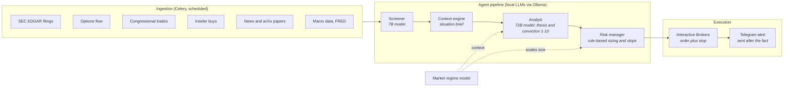

# Helios

Helios is an autonomous trading research system. It watches market events, has a local large language model write an investment thesis with a stated conviction score (1 to 10), sizes any resulting trade under fixed rules written in code, and places the order with Interactive Brokers without a human approval step. Every decision, including the ones it passes on, is logged with its thesis and conviction before the outcome is known.

It is a personal research project, not a product and not financial advice. It trades real money at deliberately small size and can lose it.

## Research question

Does the conviction an LLM states for a trade predict that trade's return?

The model's 1 to 10 conviction score is recorded at the moment of decision, and each position's outcome (return and return relative to SPY at 30, 60 and 90 days, and at exit) is recorded against it later. The question is whether higher stated conviction goes with better outcomes, or whether the number carries no information.

### Why evaluation is forward only

There is no backtest, by design. The analyst is a general-purpose LLM whose training data almost certainly includes the price history, news and filings of the stocks it reasons about. A backtest over any period before its training cutoff can't separate reasoning from memory, and no choice of window fixes that, because the contamination is in the model weights rather than in the data pipeline. Only decisions made before their outcomes existed count as evidence.

To make that forward record usable:

- each decision stores the full thesis as JSON, the stated conviction and sub-scores, the risk verdict, the position size and the stop;
- SPY is recorded at entry, so return relative to SPY is computed for every trade at exit;
- slippage between the decision price and the fill is recorded for each order;
- the code version (git commit) that made each decision is stored with it.

Known limits: the live sample is small (4 closed trades and 2 open as of 2026-10-31), so it has little statistical power yet; transaction costs beyond measured slippage are not modeled; and the market regime model is fit on the same history it is applied to.

## How it works



1. An event arrives, for example an 8-K filing or an unusual options trade on a watchlist ticker.
2. The screener (Qwen 2.5 7B) decides whether it is relevant enough to analyze.
3. The context engine builds a brief: price action, fundamentals, the catalyst calendar and past theses retrieved from a vector store.
4. The analyst (Qwen 2.5 72B) writes a thesis with a conviction score, an upside and downside estimate and a bucket (Compounder, Accelerator or Moonshot). It recommends OPEN, ADD, HOLD, WATCH, TRIM or EXIT.
5. The risk manager sizes the trade from fixed tables, scaled by the market regime, sets a stop and enforces the limits below.
6. Orders that pass go to Interactive Brokers automatically, with a stop. A Telegram message reports the trade afterwards.

All model inference runs locally on two consumer GPUs. No cloud AI service is used.

## Rules the model can't override

These are deterministic code, covered by unit tests. The model's output is an input to them; it has no path to change a limit.

| Rule | Value in code (`config.py`, `risk_manager.py`) |
|---|---|
| Analyst conviction needed to pass a buy on | 5 or higher, with upside/downside at least 2:1 |
| Conviction needed to queue a buy, by account size | 5 (25,000 and up), 6 (5,000 to 25,000), 7 (under 5,000) |
| Drawdown checked before every buy | at 10% below the high-water mark, buying halts until a person resumes it |
| Drawdown checked every 30 minutes | at 15% below the high-water mark on 2 reads in a row, the same halt is set |
| What a halt stops | new buys only; sells and protective stops keep working |
| Maximum entry size by bucket | Compounder 12%, Accelerator 7%, Moonshot 2% (large-account values) |
| Risk per trade | a stop-out may cost at most 2% of equity |
| Total open risk ("portfolio heat") | 7% of equity |
| Concentration | 35% per theme, 60% total AI infrastructure, 10% total Moonshots |
| Cash per trade | at most 20% of the cash on hand |
| Correlation | size cut by 25% when a new name's returns correlate at 0.7 or more with 2 or more held positions |
| Stops | ATR-based for Compounders (2 to 3 ATR) and Accelerators (1.5 to 2 ATR); Moonshots at a 20% maximum loss |
| Trailing stops | Compounders from a 30% gain (15 to 20% trail), Accelerators from a 20% gain (10 to 15% trail) |

Small accounts: percentage caps sized for a large account round down to zero shares on a small one, so caps rescale in three tiers (under 5,000, 5,000 to 25,000, and 25,000 and up). The live account is in the smallest tier, where single positions can be a much larger share of the account than the table shows, and the conviction bar is 7.

## Status

- Paper trading from June to August 2026; live since 2026-08-17. A `TRADING_ENV` setting selects paper or live, and every stateful table is separated by environment so the two records never mix. Live trading also needs a second, separate opt-in.
- Live record so far: 6 buys (the last on 2026-09-17), 4 closed trades, 2 open positions. Most recent analyst passes size to zero or one share at the current account size, which is why there have been no new live entries since mid-September.
- Code: about 49,000 lines of Python in 166 files; 93 test files with 974 tests, run on every push by GitHub Actions; 730 commits since 2026-06-20.

## Running the tests

```bash
python3 -m venv venv
venv/bin/pip install -r requirements.txt
venv/bin/python -m pytest -q tests
```

The tests don't need a broker, a database or a GPU; anything that would touch the real database is blocked by a test fixture.

## Running the system

```bash
# Ubuntu prerequisites
sudo apt install -y python3-venv python3-pip build-essential redis-server
curl -fsSL https://ollama.ai/install.sh | sh

# venv, dependencies, a .env template and the Ollama models
bash setup.sh

# Fill in .env (database, Telegram, market-data keys, CONTACT_EMAIL).
# TRADING_ENV=paper is the default. Start IBKR TWS or IB Gateway with the API enabled, then:
./launch.sh          # dashboard at http://localhost:8501
```

For unattended operation, see [`deploy/systemd/`](deploy/systemd/).

## Repository layout

| Path | Contents |
|---|---|
| `main.py`, `tasks.py` | Entry point and the Celery task schedule (ingestion, pipeline runs, monitors) |
| `agents/` | Screener, analyst, market regime model, candidate scanner, pipeline orchestration |
| `risk_manager.py`, `execution.py`, `ibkr.py` | Sizing and stops, order execution, broker client |
| `context_engine.py`, `vector_store.py`, `knowledge_loader.py` | Situation briefs, vector-store retrieval, knowledge base loading |
| `ingestion/` | One module per data source (EDGAR, options flow, insider, congressional, macro, news) |
| `catalyst_service/` | Earnings, sector and macro event calendar |
| `knowledge/` | Watchlist, sector theses and risk rules in markdown, loaded into prompts |
| `db.py`, `config.py` | Postgres schema and migrations; every tunable limit |
| `dashboard.py`, `telegram_bot.py` | Streamlit dashboard and Telegram bot |
| `deploy/` | systemd units, watchdog and log rotation |
| `scripts/` | Manual checks, readouts and one-off setup |
| `tests/` | Unit tests |
| `research-log/` | AI usage log |

## AI assistance

Much of this code was written with an AI coding assistant (Claude Code). Since October 2026 every AI session on this repository is logged in [`research-log/`](research-log/): each request, the AI-refined version of it, what changed, which files and functions the AI generated, and the commit. The protocol is in [`.claude/CLAUDE.md`](.claude/CLAUDE.md).

## License and contact

MIT License, see [`LICENSE`](LICENSE).

Luke Puzenski, lpuzenski@gmail.com
