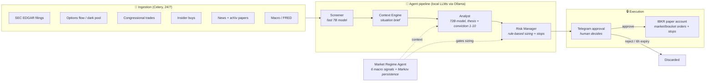

# ☀️ Helios Hedgefund

An autonomous **trading research system** that watches markets around the clock, generates AI-scored investment theses, sizes positions under a rule-based risk framework — and never executes a trade without explicit human approval.

**Paper trading only.** This is a personal research project studying whether an LLM-driven agent pipeline can make consistently good trading decisions. Every decision, conviction score, and outcome is logged to build a long-term dataset for analysis.

> ⚠️ **Not financial advice. Not a product.** Nothing here is a recommendation to buy or sell anything. Run at your own risk, on a paper account.

---

## How it works

Market events flow through a pipeline of specialized agents. Each stage can kill a candidate; only trades that survive every gate — and then get a human ✅ on Telegram — reach the broker.



### The pipeline in one trade

1. **An event fires** — say, an 8-K filing or an unusual options sweep on a watchlist ticker.
2. **Screener** (fast local LLM) decides in seconds whether it's relevant and urgent.
3. **Context Engine** assembles a situation brief: price action, fundamentals, catalyst calendar, prior theses from the vector store.
4. **Analyst** (large local LLM) writes an investment thesis with a 1–10 conviction score, an upside/downside estimate, and a bucket classification (Compounder / Accelerator / Moonshot). Below conviction 5 or 2:1 upside/downside, it dies here.
5. **Risk Manager** sizes the position from a bucket × conviction table, scaled by the current market regime multiplier, and computes an ATR-based stop. Concentration caps (per-position, per-theme, total moonshot exposure) are enforced here.
6. **Telegram** sends the full thesis with Approve / Reject buttons. Unapproved trades expire in 6 hours. **There is no autonomous execution path.**
7. On approval, the order goes to **Interactive Brokers** (paper), a stop is placed, and the trailing-stop monitor takes over.
8. At 30/60/90 days, outcomes are recorded against the original thesis — the dataset that makes this research rather than gambling.

---

## The interesting parts

**🎛️ Market regime engine** — Seven weighted signals (trend, VIX with a contrarian guard, liquidity, credit spreads, breadth, volume, and an empirical **Markov persistence signal**) produce a 0–100 score mapped to five regimes, from Strong Risk-On to Strong Risk-Off. The regime scales every position size — a 9/10-conviction idea in a Risk-Off regime still gets cut in half.

**🔗 Markov persistence signal** — Classifies each day into bull/sideways/bear from 20-day SPY returns and estimates a transition matrix from **non-overlapping windows** (overlapping windows share 19/20 closes and wildly overstate trend stickiness — a subtle bias most retail backtests have). The current state's `P(→bull) − P(→bear)` feeds the regime score.

**🛡️ Risk framework as code** — Drawdown halt at −10%, per-bucket entry caps (12% / 7% / 2%), theme concentration limits, ATR stops by bucket, trailing stops that activate after gains, and a startup reconciliation pass that detects positions the broker knows about but the database doesn't — then adopts them with a conservative stop and flags them for human review.

**🧠 Local-first AI** — All LLM inference runs locally on Ollama (Qwen 2.5 at 7B/72B/3B for screening/analysis/chat). No API costs, no data leaves the machine, and every agent degrades gracefully to keyword heuristics if the model server is down.

**📚 Knowledge base as strategy** — The watchlist, sector theses, risk rules, and portfolio philosophy live in versioned markdown (`knowledge/`), loaded into agent prompts and a ChromaDB vector store. Changing strategy is a git commit, not a code change.

**🔧 Fault tolerance** — Position/stop reconciliation every 15 minutes, approval auto-expiry, implausible-price rejection, schema-versioned migrations, and a process manager that supervises every service with logs surfaced in the dashboard.

---

## Stack

| Layer | Tech |
|---|---|
| Agents / LLMs | Ollama (Qwen 2.5 3B/7B/72B), custom pipeline in Python |
| Execution | Interactive Brokers TWS API (`ib_insync`), paper account |
| Orchestration | Celery + Redis — ~20 scheduled tasks, from 5-min portfolio snapshots to weekly calendar refreshes |
| Data | Postgres (Supabase), ChromaDB vector store, SQLite catalyst calendar |
| Market data | Polygon, Alpaca data API, yfinance, FRED, SEC EDGAR, Unusual Whales, Quiver |
| UI | Streamlit dashboard (portfolio, regime, signals, logs, manual trade) + Telegram bot |
| Ops | systemd service, single-command launch, ~14k lines of Python, CI via GitHub Actions |

---

## Screenshots

<!-- TODO: add dashboard screenshots


-->

---

## Running it

```bash
# Ubuntu prerequisites
sudo apt install -y python3-venv python3-pip build-essential redis-server
curl -fsSL https://ollama.ai/install.sh | sh

# Setup: venv, dependencies, .env template, Ollama models
bash setup.sh

# Fill in .env (Supabase, Telegram, market-data API keys),
# start IBKR TWS/Gateway with API enabled on port 7497 (paper), then:
./launch.sh          # dashboard at http://localhost:8501
```

For unattended operation, see [`deploy/systemd/`](deploy/systemd/).

Verification: `python test_connection.py` (broker), `python smoke_test.py` (models/data), `python -m pytest tests/` (unit tests).

---

## Design principles

1. **A human approves every trade.** The AI proposes; it never disposes.
2. **Risk rules are code, not vibes.** Sizing, stops, and concentration limits are deterministic and unit-tested — the LLM cannot override them.
3. **Measure everything.** Every thesis is scored against its 30/60/90-day outcome. The goal is to learn whether the system's conviction means anything — including the possibility that it doesn't.
4. **Fail toward safety.** Any data source, model, or service going down degrades the system toward *not trading*, never toward trading blind.
